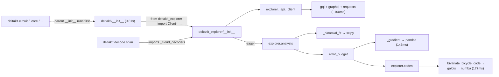

# #51 investigation notes

Measured 2026-10-10 on an Apple Silicon Mac, Python 3.14.6, `uv sync --group test`, `deltakit` @ `6c45d63`,
`deltakit-explorer` @ `a2d3442`. Warm cache, median of 5 fresh interpreters.

Scratch tools (agent artifacts, not for upstream):
- `import_profile.py`: per-target wall time and self-time grouped by top-level package
- `import_blame.py`: which deltakit module first pulls in each heavy dependency

Both live in the agent's scratch dir. Re-run: `.venv/bin/python <script>`.

## 1. Wall time per import target

| `import ...` | median (s) |
|---|---|
| `deltakit` | 0.813 |
| `deltakit.circuit` | **0.811** |
| `deltakit_circuit` (component directly) | **0.025** |
| `deltakit_core` | 0.094 |
| `deltakit_decode` | 0.401 |
| `deltakit_explorer` | 0.823 |
| `deltakit_explorer._api._client` | 0.824 |
| `deltakit_explorer.analysis` | 0.828 |
| `deltakit_explorer.codes` | 0.817 |
| `galois` (alone) | 0.267 |
| `scipy.optimize` (alone) | 0.195 |

**Takeaway:** `deltakit.circuit` costs 32× more than `deltakit_circuit` (0.811s vs 0.025s). The difference is
entirely `deltakit/__init__.py` → `from deltakit_explorer import Client`. Python must execute a package's
`__init__` before any submodule, so every `deltakit.<x>` import pays for the whole explorer.

Even `deltakit_explorer._api._client` (just the client) costs 0.82s, because `deltakit_explorer/__init__.py`
does `from deltakit_explorer import analysis` eagerly.

## 2. Self time by third-party package (`import deltakit`, total ~855 ms)

| package | ms | % |
|---|---|---|
| pandas | 125 | 14.6 |
| scipy | 123 | 14.3 |
| matplotlib | 104 | 12.2 |
| numba | 81 | 9.4 |
| galois | 53 | 6.2 |
| networkx | 42 | 4.9 |
| numpy | 41 | 4.8 |
| graphql (+gql) | 31 (+~17) | 3.7 |
| deltakit_explorer itself | 17 | 2.0 |

## 3. Who pulls in what (first importer chain)

| dependency | cumulative ms | pulled in by |
|---|---|---|
| galois (→ numba, llvmlite) | 177 | `explorer.codes._bivariate_bicycle_code` ← `explorer.codes` ← `explorer.analysis.error_budget._memory` ← `_generation` |
| pandas | 145 | `explorer.analysis.error_budget._gradient` ← `_budget` ← `error_budget` ← `explorer.analysis` |
| numba | 90 | (via galois) |
| networkx | 51 | `deltakit_core.decoding_graphs._decoding_graph` |
| gql + graphql | 78 | `explorer._api._gql_client` ← `explorer._api._client` |
| matplotlib | 44+ | `deltakit_decode._mwpm_decoder` ← `deltakit_decode` |
| requests | 20 | `explorer._api._api_v2_client` |
| coverage | 15 | numba's coverage support, only because `coverage` is installed in the test env. Not a real user cost; exclude from the comment. |

## 4. Structure that matters for a fix

- Meta-package shims (`src/deltakit//__init__.py`) do `from deltakit_ import *` and compute
  `__all__ = [s for s in dir() if not s.startswith("_")]`. A lazy approach needs an explicit `__all__` (or a `.pyi`
  stub via `lazy_loader.attach_stub`).
- `deltakit.decode` shim also imports `deltakit_explorer._cloud_decoders`, so it will stay slow until explorer is fixed.
- `tests/unit/test_namespace_reexports.py` checks that each shim mirrors upstream's public API exactly. Any lazy
  version has to keep passing it (good regression guard already in place).
- `lazy_loader` is **not** currently a dependency. Options:
  - `lazy_loader` (what SPEC-0001 recommends; adds a small dep; `.pyi` stubs keep mypy/IDE/Sphinx happy)
  - stdlib PEP 562 module `__getattr__` (no new dep, a bit more boilerplate)
  - PEP 810 `lazy import` syntax is new in Python 3.15. It can't be used until 3.15 is the minimum version, but it's worth knowing about.

## 5. Proposed plan (for the issue comment)

1. **Meta-package (this repo), small PR:** make `deltakit.Client` lazy in `deltakit/__init__.py`.
   Expected `import deltakit.circuit`: 0.81s → about the cost of `deltakit_circuit` alone (0.025s lower bound).
   **Verified** by simulating a no-op `deltakit/__init__` (empty module object with the real `__path__` placed in
   `sys.modules`, then `import deltakit.circuit`): **0.025s in 5/5 runs, and pandas/galois are not loaded.**
   `import deltakit` drops to near zero until `deltakit.Client` is touched.
2. **deltakit-explorer (component repo):**
   a. lazy `analysis` in `deltakit_explorer/__init__.py`, so the client no longer pays for analysis
   b. lazy `error_budget` in `analysis/__init__.py` (removes pandas, galois and numba from the common path)
   c. optionally defer `galois` inside `_bivariate_bicycle_code` to the functions that need it
3. Add a regression test: assert `pandas`/`galois`/`numba` are not in `sys.modules` after `import deltakit.circuit`.

Questions for maintainers:
- After the #332 split, should explorer changes go to `Deltakit/deltakit-explorer` as a separate PR/issue?
- `lazy_loader` dependency vs stdlib `__getattr__`?
