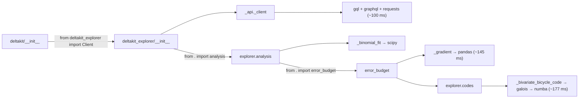

<!--
DRAFT: Alex, edit this into your own voice before posting on
https://github.com/Deltakit/deltakit/issues/51
Delete this comment block before posting.
Before posting, re-run the numbers on a clean `uv sync` (no test group) so `coverage` etc. aren't in the env.
-->

Hi @nelimee @rolandriver, I'd like to help with this one. I profiled the current `main` to see where the time goes. Summary below.

**Setup:** macOS (Apple Silicon), Python 3.14, `deltakit` @ `6c45d63`, `deltakit-explorer` 0.9.x. Warm cache, median of 5 fresh interpreters.

### The main cause: every `deltakit.` import loads all of `deltakit_explorer`

| `import ...` | median |
|---|---|
| `deltakit_circuit` (component directly) | 0.025 s |
| `deltakit.circuit` (via meta-package) | **0.811 s** |
| `deltakit` | 0.813 s |
| `deltakit_explorer` | 0.823 s |

`deltakit/__init__.py` does `from deltakit_explorer import Client`. Python runs a package's `__init__` before any of its submodules, so `import deltakit.circuit` pays for the whole explorer stack. As a quick check, I bypassed the top-level `__init__` (an empty module with the real `__path__`). `import deltakit.circuit` then took **0.025 s** (32× faster), and `pandas`/`galois` were never loaded.

Inside `deltakit_explorer`, the cost comes from eager imports in `__init__` files:

The largest third-party costs for `import deltakit`, by self time (total ~0.85 s): pandas 125 ms, scipy 123 ms, matplotlib 104 ms (via `deltakit_decode._mwpm_decoder`), numba 81 ms, galois 53 ms, networkx 42 ms.

### Proposed approach

1. **Meta-package (this repo), small PR:** make `deltakit.Client` lazy, so `deltakit.circuit`, `deltakit.core` etc. only pay for their own component. This alone takes `import deltakit.circuit` from ~0.8 s to ~0.03 s. (`deltakit.decode` would stay slow because its shim imports `deltakit_explorer._cloud_decoders`, which is why step 2 matters.)
2. **`deltakit-explorer`:** lazy-load `analysis` in the package `__init__` and `error_budget` in `analysis/__init__`. Optionally, defer `galois` to the functions in `_bivariate_bicycle_code` that need it. That keeps pandas/galois/numba off the common path, including for users who only want the `Client`.
3. Add a regression test asserting that heavy modules aren't in `sys.modules` after `import deltakit.circuit`, alongside the existing `test_namespace_reexports.py`.

### Two questions before I start
- Since the split in #332, should the explorer changes be a separate issue/PR in `Deltakit/deltakit-explorer`?
- Would you like me to follow SPEC-0001 with `lazy_loader` (one new small dependency; `.pyi` stubs keep mypy/IDEs/Sphinx happy), or would you rather avoid a new dependency and use a plain PEP 562 module `__getattr__`?

If that sounds reasonable, I'm happy to take step 1 first. Could you assign it to me?
